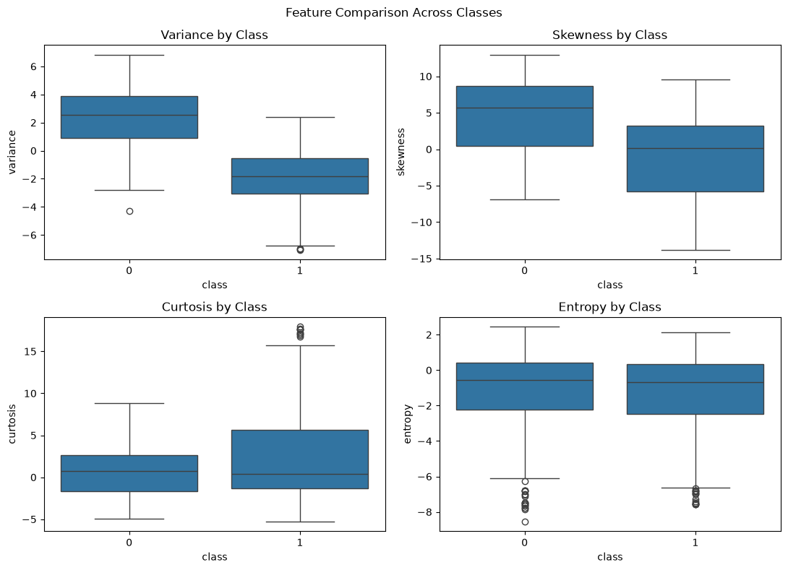
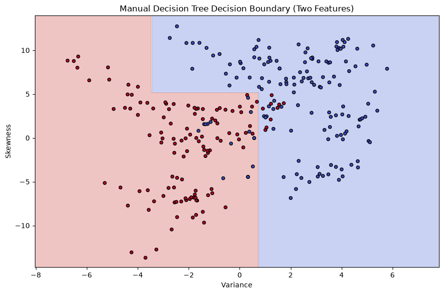
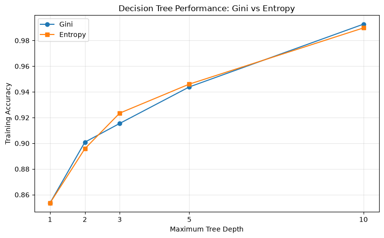
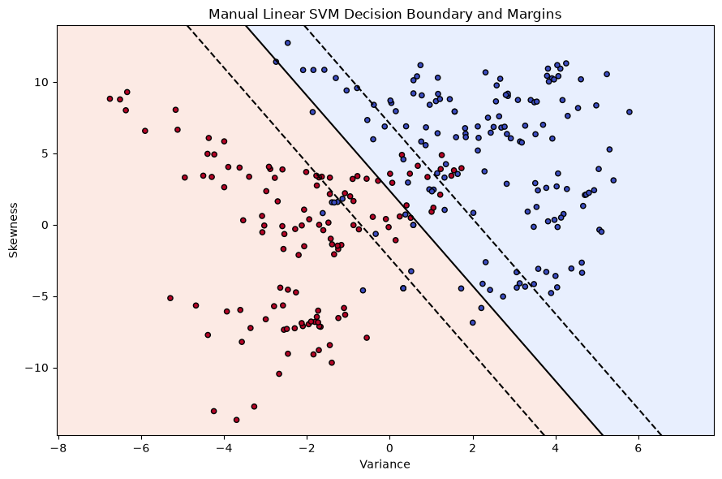
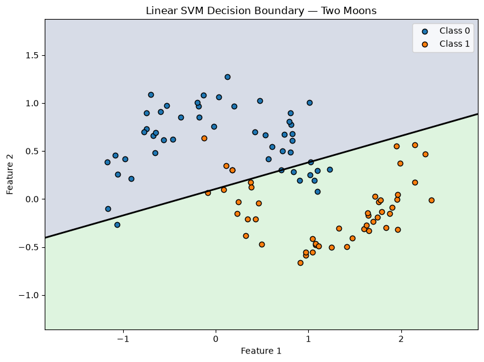
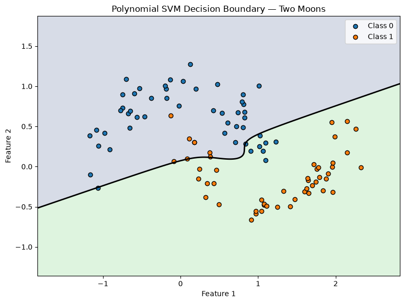
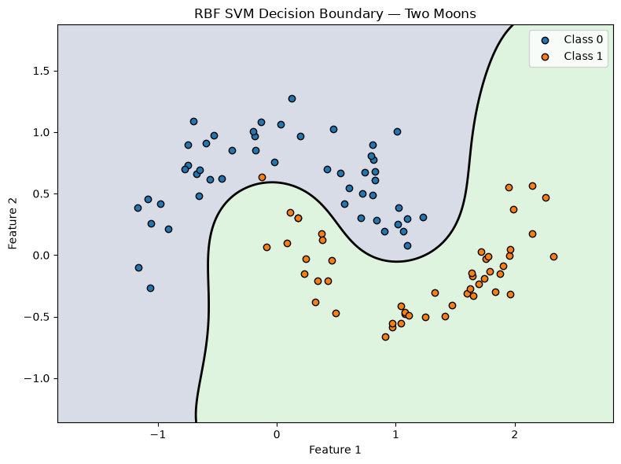

# Banknote Authentication — Machine Learning

## Project Overview

This project explores decision trees and Support Vector Machines (SVMs) for classifying authentic and forged banknotes. Manual implementations are compared with scikit-learn models, and decision boundaries are visualized using two features. The final comparison uses all four features.

## 1. Dataset Exploration

The dataset contains 1,372 observations, four numerical features, and one binary target. There are no missing values.

**Dataset distribution / exploration plot**

- The four features have different distributions, with some showing skewness and potential outliers.
- Skewness and curtosis have a strong negative correlation (-0.79), while the other feature pairs show weak to moderate correlations.
- Variance and skewness show clear differences between the two classes, suggesting that they may be useful for classification.
- Curtosis also shows differences between classes, although their distributions overlap. Entropy shows considerable overlap between the classes.
- Overall, the features provide useful information for distinguishing the classes, but no single feature perfectly separates them.

## 2. Decision Tree — Two Features

A decision tree was implemented from scratch using Gini impurity and entropy. Its predictions were compared with a scikit-learn decision tree.

**2.1 — Decision tree visualization**

The decision tree uses all four features, with **variance** as the root splitting feature. Subsequent splits use skewness, curtosis, and variance to classify banknotes. The tree has a maximum depth of 3, making its decision rules relatively easy to interpret. The node colors and class counts show how the splits separate the two classes, although some leaf nodes still contain mixed-class observations.

**2.2 — Manual decision tree decision boundary**

The manual decision tree creates rectangular decision regions using variance and skewness. Most observations fall within regions associated with their respective classes, although some overlap remains near the decision boundaries. The splits are easy to interpret, but the relatively simple boundaries may not capture every pattern in the data.

**2.3 — Scikit-learn decision tree decision boundary**

The scikit-learn decision tree produces rectangular decision regions using variance and skewness. Its boundary closely matches the manual implementation, showing that both approaches learned similar classification rules from the same features and training data. Some observations overlap across the predicted regions, indicating that these two features do not perfectly separate the classes.

**2.4 — Gini impurity and entropy: effect of tree depth**

Increasing tree depth improved training accuracy. Deeper trees can also become more complex, so cross-validation is useful when assessing performance.

## 3. Linear SVM — Two Features

A linear SVM was implemented from scratch using hinge loss, a regularization term, and gradient-based optimization. Its performance was compared with scikit-learn's linear SVM.

### 3.1 — Manual Linear SVM Decision Boundary and Margins

### 3.2 — Effect of Regularization Parameter \(C\)

| \(C\) | Train Accuracy | Test Accuracy |
|---:|---:|---:|
| 0.01 | 0.8824 | 0.8836 |
| 0.1 | 0.8833 | 0.8873 |
| 1 | 0.8806 | 0.8764 |
| 10 | 0.8806 | 0.8764 |

### 3.3 — Effect of Learning Rate

| Learning Rate | Train Accuracy | Test Accuracy |
|---:|---:|---:|
| 0.00001 | 0.8833 | 0.8836 |
| 0.00005 | 0.8797 | 0.8764 |
| 0.0001 | 0.8806 | 0.8764 |
| 0.0002 | 0.8806 | 0.8764 |

**Observation:** The manual implementation achieved results close to scikit-learn's linear SVM. Both the learning rate and \(C\) affected optimization and classification performance. In these experiments, smaller values of \(C\) gave slightly better test accuracy.

## 4. Kernel SVM Comparison

Linear, polynomial, and RBF kernels were compared on a nonlinear two-moons dataset.

### 4.1 — Linear SVM Decision Boundary

**Observation:** The linear kernel creates a straight decision boundary, which cannot fully capture the curved structure of the two-moons dataset. Several observations lie in the opposite class region, illustrating the limitations of a linear model on nonlinear data.

### 4.2 — Polynomial SVM Decision Boundary

**Observation:** The polynomial kernel produces a curved decision boundary that captures some nonlinear structure. However, it does not separate the two classes as effectively as the RBF kernel, indicating that the chosen polynomial model is less suitable for this dataset.

### 4.3 — RBF SVM Decision Boundary

**Observation:** The RBF kernel creates a flexible, nonlinear boundary that follows the two-moons structure more closely. It separates the classes more effectively than the linear and polynomial kernels, consistent with its 99% test accuracy.

**Test-set performance**

| Kernel | Accuracy | Precision | Recall | F1-score |
|---|---:|---:|---:|---:|
| Linear | 0.8700 | 0.8364 | 0.9200 | 0.8762 |
| Polynomial | 0.8300 | 0.8235 | 0.8400 | 0.8317 |
| RBF | 0.9900 | 1.0000 | 0.9800 | 0.9899 |

**Observation:** The RBF kernel performed best on the nonlinear dataset, achieving 99% test accuracy. Its flexible decision boundary captured the structure of the two-moons data more effectively than the linear and polynomial kernels.

## 5. Final Comparison Using All Four Features

The decision tree and SVM models were evaluated using all four banknote features. Decision trees used the original features, while SVMs used standardized features.

### 5.1 — Four-Feature Model Performance Comparison

**Train-test split results**

| Model | Train Accuracy | Test Accuracy | Precision | Recall | F1-score |
|---|---:|---:|---:|---:|---:|
| Manual Decision Tree | 0.9435 | 0.9236 | 0.8797 | 0.9590 | 0.9176 |
| Sklearn Decision Tree | 0.9435 | 0.9236 | 0.8797 | 0.9590 | 0.9176 |
| Manual Linear SVM | 0.9872 | 0.9745 | 0.9457 | 1.0000 | 0.9721 |
| Sklearn Linear SVM | 0.9863 | 0.9745 | 0.9457 | 1.0000 | 0.9721 |
| RBF SVM | 1.0000 | 1.0000 | 1.0000 | 1.0000 | 1.0000 |

### 5.2 — RBF SVM Regularization Experiment

**Effect of \(C\) on train-test performance**

| \(C\) | Train Accuracy | Test Accuracy |
|---:|---:|---:|
| 0.1 | 0.9918 | 0.9855 |
| 1 | 1.0000 | 1.0000 |
| 10 | 1.0000 | 1.0000 |
| 100 | 1.0000 | 1.0000 |

**Observation:** The RBF SVM achieved the strongest results in the reported train-test experiment. The manual and scikit-learn decision trees produced matching results, and both linear SVM implementations performed similarly. Increasing \(C\) beyond 1 did not improve the RBF SVM's reported performance.

## 6. Five-Fold Cross-Validation Results

The models were evaluated using five-fold stratified cross-validation. The table reports mean performance across folds.

| Model | Mean CV Accuracy | CV Std. Dev. | Mean CV Precision | Mean CV Recall | Mean CV F1 |
|---|---:|---:|---:|---:|---:|
| Manual Decision Tree | 0.9410 | 0.0085 | 0.9365 | 0.9197 | 0.9280 |
| Scikit-learn Decision Tree | 0.9410 | 0.0085 | 0.9365 | 0.9197 | 0.9280 |
| Manual Linear SVM | 0.9847 | 0.0091 | 0.9685 | 0.9984 | 0.9831 |
| Scikit-learn Linear SVM | 0.9840 | 0.0076 | 0.9685 | 0.9967 | 0.9823 |
| RBF SVM | 1.0000 | 0.0000 | 1.0000 | 1.0000 | 1.0000 |

### Observations

- **Decision Trees:** The manual and scikit-learn implementations achieved identical results, with 94.10% mean CV accuracy.
- **Linear SVMs:** Both implementations performed strongly, achieving approximately 98.4% accuracy and similar F1-scores.
- **RBF SVM:** It achieved perfect scores across all five folds, making it the strongest model in this experiment.
- **Consistency:** The low standard deviations indicate relatively consistent accuracy across folds for the decision trees and linear SVMs. The RBF SVM had zero observed variation.

## 7. Conclusion

The decision trees provided interpretable classification rules, while both linear SVM implementations achieved higher cross-validation accuracy. The RBF SVM performed best, with perfect scores across the five folds. However, these results apply to the chosen dataset and model settings; perfect cross-validation performance does not guarantee perfect predictions on all unseen data.

