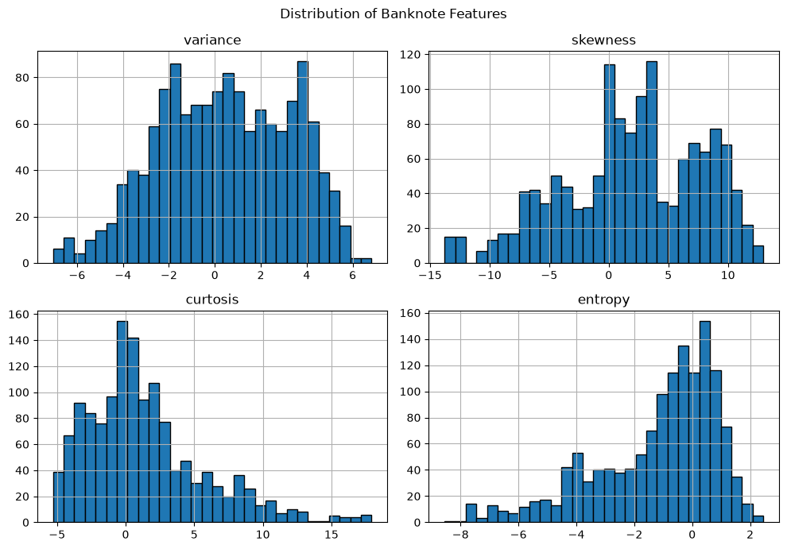

# Banknote Authentication — Machine Learning

## Project Overview

This project explores decision trees and Support Vector Machines (SVMs) for classifying authentic and forged banknotes. Manual implementations are compared with scikit-learn models, and decision boundaries are visualized using two features. The final comparison uses all four features.

## 1. Dataset Exploration

The dataset contains 1,372 observations, four numerical features, and one binary target. There are no missing values.

**Dataset distribution / exploration plot**

## 2. Decision Tree — Two Features

A decision tree was implemented from scratch using Gini impurity and entropy. Its predictions were compared with a scikit-learn decision tree.

**2.1 — Decision tree visualization**

[Paste plot here]

**2.2 — Manual decision tree decision boundary**

[Paste plot here]

**2.3 — Scikit-learn decision tree decision boundary**

[Paste plot here]

**2.4 — Gini impurity: effect of tree depth**

[Paste plot here]

**2.5 — Entropy: effect of tree depth**

[Paste plot here]

**Observation:** Increasing tree depth improved training accuracy. Deeper trees can also become more complex, so cross-validation is useful when assessing performance.

## 3. Linear SVM — Two Features

A linear SVM was implemented from scratch using hinge loss, a regularization term, and gradient-based optimization. Its performance was compared with scikit-learn's linear SVM.

**3.1 — Manual linear SVM decision boundary and margins**

[Paste plot here]

**3.2 — Effect of regularization parameter \(C\)**

[Paste plot here]

**3.3 — Effect of learning rate**

[Paste plot here]

**Observation:** The manual implementation produced results close to those of scikit-learn. The learning rate and regularization parameter influenced optimization and classification performance.

## 4. Kernel SVM Comparison

Linear, polynomial, and RBF kernels were compared on a nonlinear two-moons dataset.

**4.1 — Linear SVM decision boundary**

[Paste plot here]

**4.2 — Polynomial SVM decision boundary**

[Paste plot here]

**4.3 — RBF SVM decision boundary**

[Paste plot here]

**Observation:** The RBF kernel performed best on this nonlinear dataset, achieving an accuracy of 99% on the held-out test set. This illustrates how kernels can model nonlinear decision boundaries.

## 5. Final Comparison Using All Four Features

The decision tree and SVM models were evaluated using all four banknote features. The decision trees used the original features, while SVMs used standardized features.

**5.1 — Four-feature model performance comparison**

[Paste plot here, if generated]

**5.2 — RBF SVM regularization experiment**

[Paste plot here, if generated]

**Observation:** The RBF SVM achieved the strongest results in the reported train-test experiment. The manual and scikit-learn decision trees produced matching results, while both linear SVM implementations performed similarly.

## 6. Five-Fold Cross-Validation Results

The following results are the mean scores across five stratified folds. These results are used for the final model comparison rather than relying only on a single train-test split.

| Model | Mean CV Accuracy | CV Std. Dev. | Mean CV Precision | Mean CV Recall | Mean CV F1 |
|---|---:|---:|---:|---:|---:|
| Manual Decision Tree | 0.9410 | 0.0085 | 0.9365 | 0.9197 | 0.9280 |
| Scikit-learn Decision Tree | 0.9410 | 0.0085 | 0.9365 | 0.9197 | 0.9280 |
| Manual Linear SVM | 0.9847 | 0.0091 | 0.9685 | 0.9984 | 0.9831 |
| Scikit-learn Linear SVM | 0.9840 | 0.0076 | 0.9685 | 0.9967 | 0.9823 |
| RBF SVM | 1.0000 | 0.0000 | 1.0000 | 1.0000 | 1.0000 |

**6.1 — Cross-validation model comparison plot**

[Paste plot here, if generated]

**6.2 — Cross-validation score variation or standard-deviation plot**

[Paste plot here, if generated]

## 7. Conclusion

The decision trees provided an interpretable approach, while the manual and scikit-learn linear SVMs achieved approximately 98.4% mean cross-validation accuracy. The RBF SVM achieved perfect scores across the five folds and was the strongest model in this experiment.

These results apply to the dataset and model settings used here. Perfect cross-validation performance does not guarantee perfect predictions on every unseen dataset.

